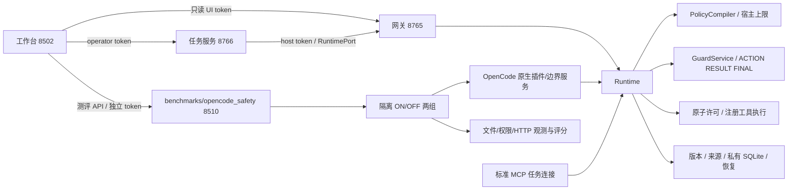

# 当前架构与统一入口

2026-10-25，2.0.0a6。业务包以 `AgentGuard/agentguard/` 为唯一源码；工作区顶层同名旧副本不是安装包入口。运行源码时从 `AgentGuard/` 启动，连接外部宿主时使用安装环境的 `python -I -m ...`，避免当前目录/PYTHONPATH 覆盖安装包。

## 网页入口

统一工作台默认 `http://127.0.0.1:8502`，支持 `?page=tasks|audit|evaluation|integration|architecture|legacy`。

| 功能 | 实现 | 数据 / 操作边界 |
|---|---|---|
| 任务工作台 | `operator_console.py` → 8766 `/jobs` | 固定应用配置，独立 operator 凭据；提交幂等、失败不自动重跑 |
| 审计记录 | `console.py` → 8765 `/v2/sessions/...` | UI 凭据只读；策略、事件、实际审查输入、内容版本、来源/恢复、用量 |
| 安全测评 | `evaluation_console.py` → 8510 `/api/*` | 新双组实验、历史选择、独立副作用评分和证据；另保留历史三场景报告 |
| Agent 接入 | `workbench.py` / `integration.py` | 共享能力表、生成检查/配置包命令；页面不执行安装或模型调用 |
| 项目架构 | `workbench.py` | 服务边界和模块职责 |
| 旧版演示 | `app.py`，通常 8501 | 独立兼容进程；配置 `AGENTGUARD_LEGACY_URL` 后内嵌，另可单独打开；未配置时显示启动命令 |

任务提交失败且尚无会话时，不显示另一任务的历史成功。测评、接入和架构不依赖有无审计会话。`AGENTGUARD_V2_REPLAY` 设置后仅显示录制审计，隐藏提交和运行导航。

`ui/v2/app.py`、`agentguard-v2-console` 和直接运行 `console.py` 均进入同一工作台。8510 的独立网页继续兼容，也能返回统一工作台；它和工作台调用同一份评测后端，没有复制评分逻辑。

## 服务与依赖方向

这些箭头表示调用方向，**不表示不同宿主共享 Runtime 实例或数据库**。网页任务经网关拥有唯一执行器；OpenCode 每窗口/任务和外部 MCP 每连接使用独立状态目录；评测两组也分别隔离。工作台不直接打开私有 SQLite。

| 层 | 主模块 | 负责的事情 |
|---|---|---|
| 公共契约 | `contracts.py`, `schemas/`, `ports.py` | JSON Schema、不可变值、RuntimePort |
| 组合根 | `application.py`, `bootstrap.py` | 可信模型配置、资源目录、工具工厂与 Runtime 组合 |
| 宿主适配 | `adapters/host.py`, `framework.py`, `http.py`, `external.py`, `opencode_host.py` | 模型上下文、工具提案、最终输出、连接生命周期和恢复清空 |
| 策略 | `policy/` | 模型候选与宿主权限上限相交；候选不能新增授权 |
| 审查 | `review/` | 长任务证据选择、协议校验、预算、ACTION/RESULT/FINAL 审查 |
| 执行 | `runtime.py`, `execution/`, `registry.py` | 工具清单校验、资源/目的地约束、原子单次许可、已执行/未知/已释放分离 |
| 状态与恢复 | `state/`, `recovery/` | 私有内容版本、来源、依赖失效、恢复计划与 ACK |
| 部署 | `connect.py`, `integration.py`, `opencode.py`, `launch.py` | 配置模板、预检查、MCP、原生插件和服务监督 |
| 展示 | `console.py`, `workbench.py`, `operator_console.py`, `evaluation_console.py` | 统一导航、调用服务 API 与展示证据 |
| 测评 | `benchmarks/opencode_safety/`（仓库独立程序） | 样例、隔离、模型出口、双组执行与评分；不随 wheel 打包 |
| 兼容 | `agentguard/` 的旧版模块、`app.py` | v1 SDK、旧演示和历史固定实验；不能用历史成绩替代 v2 验收 |

## 一次任务的安全链路

1. 可信宿主提供任务、资源、目的地和工具清单，Runtime 编译受宿主上限约束的任务策略。
2. `prepare_model_turn` 根据已释放版本构造模型实际输入；宿主提交模型输出和工具提案。
3. ACTION 审查、确定性权限/数据/配额约束和单次许可均通过后才派发工具。
4. 工具结果经 RESULT 门禁才成为下一轮可用观察；最终文本经 FINAL 门禁才对用户释放。
5. 风险阻断后由完整宿主执行恢复计划并提交清空 ACK；UNKNOWN 副作用不自动重放。已外发或删除的效果不靠恢复撤销。

OpenCode 原生链路接管上述边界及恢复；原生 UI 的工具回执不再次执行工具。ON/OFF 保持已有当前会话切换语义。通用 MCP 只接管工具与显式提交的 FINAL，不能把外部模型的隐藏上下文或直接显示纳入保护。详见 [能力与接入指南](AGENT_INTEGRATION.md)。

## 启动与配置

本工作区：`bash ai/bin/run_demo.sh`。它启动网关/任务服务/统一工作台、旧版展示服务 8501，并在没有现有评测服务时启动 8510；已有评测服务复用，退出只清理本次启动的子进程。仅打开页面不触发模型调用。旧评测进程需在空闲时重启，才能加载历史 API 和持久提交凭据。

安装包：`agentguard-v2-workbench --config /private/application.json`（安装 `[gateway,v2-console]`）；等价于 `python -m agentguard.v2.launch`。默认同时启动 8765、8766、8502，可用 `--port`、`--operator-port`、`--ui-port` 更换。评测服务是可选外部服务，不将工作区脚本硬编码到 wheel。

展示进程仅获得 UI/operator 凭据，移除配置指定的模型密钥与 host token。API 客户端限定本机 HTTP 服务、禁止重定向并限制响应大小。`AGENTGUARD_EVAL_URL` 可改评测地址；`AGENTGUARD_EVAL_TOKEN_FILE` 指向后端共享的私有提交凭据（默认 `~/.config/agentguard/eval-ui-token`），不送到浏览器。

评测程序已随仓库提供：`python3 benchmarks/opencode_safety/cli.py serve`，默认结果位于用户状态目录。8510 页面可输入自定义提示词，实时并排显示两个真实 OpenCode 的执行、审查和拦截；手动任务不计入基准 ASR。详见 [测评说明](../../benchmarks/opencode_safety/README.md)。

评测 `/api/runs` 列出输出根目录内的历史报告，`/api/status?run=<id>` 选择报告；`/api/detail?directory=...` 查看同根目录下的合成证据。提交带 `submission_id`，写入 `.submissions/` 后才启动子进程；同 ID 同参数返回已有接收结果，重启后不重新执行；接收状态不明确时拒绝自动重放。

## 目前的边界

OpenCode 原生目标仍是 1.19.4。标准 MCP/VS Code 模板不代表所有宿主已实测。任意 Shell、其他 MCP/provider、委派必须另行注册并验证边界。评测中的 Shell 是可信实验工具，不代表原生 bash 全覆盖。正常任务、故障率、误拦截和攻击成功率须分开统计；安装和回归成功不等于真实模型防护效果成立。
